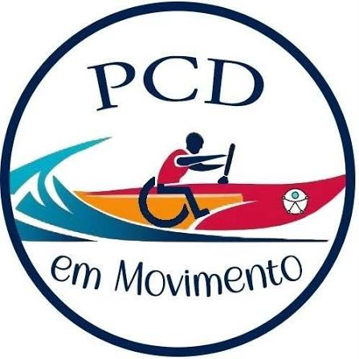

  

# PCD em Movimento - Website Institucional

Este repositório contém o código-fonte do website institucional da organização "PCD em Movimento". O projeto tem como objetivo divulgar o trabalho social realizado pela organização, que promove a inclusão social de pessoas com deficiência por meio da prática da canoa havaiana adaptada em Niterói, RJ.

## Visão Geral do Projeto

A aplicação foi desenvolvida como uma Landing Page moderna, focada em performance máxima, SEO avançado, acessibilidade universal (WCAG) e arquitetura limpa (Clean Architecture).

### Principais Funcionalidades e Acessibilidade (a11y)
- Suporte integral à navegação via teclado (Skip Links e outlines de alto contraste).
- Otimização para leitores de tela com textos alternativos detalhados, atributos ARIA dinâmicos e isolamento de elementos decorativos.
- Comportamentos visuais adaptativos que respeitam as preferências do usuário (ex: desativação de animações via `prefers-reduced-motion`).
- Player de vídeo de depoimento em alta performance com carregamento lazy e reprodução inteligente via `IntersectionObserver`.
- Componentes leves como carrosséis construídos com CSS Scroll Snap, eliminando bibliotecas pesadas de terceiros.

### Otimizações de SEO & Core Web Vitals
- **Next.js App Router**: Pré-renderização estática de alta velocidade.
- **Next Image**: Formatos de última geração (AVIF/WebP automáticos), dimensionamento anti-CLS e `priority` na imagem do Hero para otimizar o LCP (Largest Contentful Paint).
- **Next Font**: Fontes Google (`Inter` e `Fraunces`) auto-hospedadas e injetadas sem FOIT/FOUT ou layout shifts.
- **Metadata API Completa**: Tags OpenGraph, Twitter Cards, canonical URL, robots e viewport.
- **Dados Estruturados (JSON-LD)**: Schema.org para Organização Não Governamental (`NGO`) e Clube Esportivo (`SportsClub`).
- **Arquivos Nativos de Busca**: `sitemap.xml`, `robots.txt` e Web App Manifest (`manifest.webmanifest`).

## Tecnologias e Ferramentas

O projeto utiliza o ecossistema moderno de Next.js + React com estrita separação em Clean Architecture:

- **Next.js 16 (App Router)**
- **React 19**
- **TypeScript** (Strict mode)
- **CSS Modules** (Vanilla CSS Puro)
- **Tailwind CSS v4** (Variáveis globais de tema)
- **ESLint & TypeScript-ESLint**
- **Node.js & PNPM**

## Arquitetura Limpa (Clean Architecture)

- `app/core/`: Entidades de domínio puras, use-cases e interfaces de repositórios.
- `app/infrastructure/`: Implementações concretas de repositórios (ex: envio de mensagens).
- `app/components/`: Camada de UI dividida estritamente em:
  - `ui/`: Componentes atômicos e reutilizáveis (`Button`, `Section`, `SectionTitle`).
  - `layout/`: Componentes estruturais fixos (`Header`, `Footer`).
  - `features/`: Funcionalidades de negócio (`Hero`, `About`, `Project`, `Benefits`, `Location`, `Testimonials`, `Participate`, `Contact`).

## Diretrizes de Codificação e Estilos

1. **CSS Modules Restritos:**
   Todo componente React possui seu arquivo `styles.module.css`. O uso da diretiva `@apply` é proibido nos módulos.
2. **Nomenclatura Semântica:**
   Seletores de classe refletem o propósito do conteúdo, evitando classes utilitárias ou baseadas apenas em visual.
3. **Isolamento de Componentes:**
   Estrutura estrita: `NomeDoComponente/index.tsx` e `NomeDoComponente/styles.module.css`.

## Créditos

Desenvolvido por **Davi Rodrigues** (GitHub: [Mello-Davi](https://github.com/Mello-Davi)).
